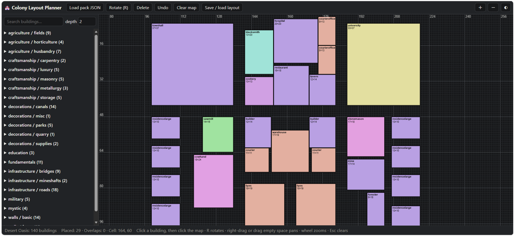

# Minecolonies Colony Layout Planner

Plan your [Minecolonies](https://minecolonies.com/) colony on a grid **before** you build it.
Feed it a style's blueprint JSON and you get:

- 🌐 [**A web planner**](https://quangnguyenlong.github.io/minecolonies-layout-planner/) (`docs/index.html`): pick buildings, rotate them, drop them on a grid, drag them around, spot overlaps.
- 📊 **An Excel workbook generator** (`src/blueprints_to_excel.py`): a building list, a color-coded palette where **1 cell = 1 block**, and an empty map to lay your colony out in.

Both tools read the same JSON, so they work with **any style pack** that has the same structure.

Example usage:



> Unofficial fan tool, not affiliated with Minecolonies. Blueprint data belongs to the authors of each style.

---

## Contents

- [Minecolonies Colony Layout Planner](#minecolonies-colony-layout-planner)
  - [Contents](#contents)
  - [Where to get the JSON](#where-to-get-the-json)
  - [Web planner](#web-planner)
    - [Quick start](#quick-start)
    - [Controls](#controls)
    - [Good to know](#good-to-know)
  - [Excel generator](#excel-generator)
    - [Install and run](#install-and-run)
    - [Options](#options)
  - [Expected JSON format](#expected-json-format)
  - [Conventions](#conventions)
  - [Troubleshooting](#troubleshooting)
  - [Credits](#credits)
  - [License](#license)

---

## Where to get the JSON

The style files come from the excellent
[**tomp2/minecolonies-style-explorer**](https://github.com/tomp2/minecolonies-style-explorer),
a web app that shows organized screenshots of the Minecolonies buildings.

Each style lives in its own folder under `public/minecolonies/`, and the file you need is
`style_indented.json`. Example (the `sandstone` folder, whose display name is *Desert Oasis*):

<https://github.com/tomp2/minecolonies-style-explorer/blob/main/public/minecolonies/sandstone/style_indented.json>

To download it, open the file on GitHub and click **Download raw file**.

To use another style, browse the
[`public/minecolonies`](https://github.com/tomp2/minecolonies-style-explorer/tree/main/public/minecolonies)
folder, open the style you like, and download its `style_indented.json` the same way.

---

## Web planner

`docs/index.html` is a single self-contained file: no install, no server, no build step.
Open it in any modern browser (or [host it on GitHub Pages](#hosting-the-web-planner-on-github-pages)).

### Quick start

1. Click **Load pack JSON** (or drag the file onto the page).
2. Pick a building in the left list. A ghost follows your cursor on the grid (1 cell = 1 block).
3. Press **R** to rotate, then click to place it.
4. Click a placed building to select it, then drag to move it, **R** to rotate it, **Delete** to remove it.

Your JSON is read locally in your browser. Nothing is uploaded anywhere.

### Controls

| Action | How |
|---|---|
| Choose a building to place | Click it in the list (click again to stop placing) |
| Place | Click on the map |
| Rotate 90° | `R` or the **Rotate** button |
| Select / move | Click / drag a placed building |
| Delete | `Delete` / `Backspace` or the **Delete** button |
| Undo | `Ctrl+Z` / `Cmd+Z` or the **Undo** button |
| Stop placing / deselect | `Esc` |
| Pan | Right-drag, middle-drag, or drag on empty space |
| Zoom | Mouse wheel or the **＋ / －** buttons |
| Search | Type in the search box above the list |
| Group depth | The `depth` box sets how many category levels form a group (default 2) |

### Good to know

- Overlapping buildings turn **red**, and the status bar counts the overlaps.
- Thin lines mark every block, stronger lines mark every **16 blocks** (chunk borders). Coordinates are labeled every 16.
- Your pack and layout are remembered in the browser (`localStorage`), so a refresh keeps your work.
- **Save / load layout** shows your layout as JSON text to copy or paste back, or you can import a file:

```json
{ "v": 1, "items": [
  { "g": "fundamentals", "n": "townhall", "x": 37, "y": 32, "z": 37, "r": false, "px": 10, "pz": 8 }
] }
```

`r` is whether the building is rotated 90°, and `px` / `pz` are the top-left cell.

---

## Excel generator

`blueprints_to_excel.py` turns a style JSON into a workbook with three tabs:

| Tab | What it contains |
|---|---|
| **Buildings** | Flat list: group, building, width (x), length (z), height (y), footprint, plus clickable links to each building in the palette |
| **Building Palette** | Every building drawn at **1 cell = 1 block** with a color per group, a bold outline and its name. The **original** is on the left and the **rotated 90°** version sits right beside it |
| **Colony Map** | An empty square-cell grid (default 160 × 160) with a ruler every 10 and chunk lines every 16 |

Copy a block from the palette (select its rectangle, `Ctrl+C`) and paste it into **Colony Map**. To rotate
it, use the rotated copy next to it.

### Install and run

Requires Python 3 and [`openpyxl`](https://pypi.org/project/openpyxl/).

```bash
pip install openpyxl
python blueprints_to_excel.py sandstone.json
```

The output is named after the pack's `displayName` (for example `desert_oasis_layout.xlsx`).

### Options

| Option | Default | Description |
|---|---|---|
| `-o`, `--output` | `<displayName>_layout.xlsx` | Output file |
| `--group-depth N` | `2` | Category levels per color group (`1` = fewer, bigger groups) |
| `--max-width N` | `150` | Palette width in columns before it wraps to a new row |
| `--map-size N` | `160` | Colony Map size (N × N cells) |

```bash
python blueprints_to_excel.py sandstone.json -o my_colony.xlsx --group-depth 1 --map-size 200
```

Blueprints without a `size` are skipped with a warning, and empty categories are ignored.

---

## Expected JSON format

Categories nest to any depth, and each blueprint needs a `size`:

```json
{
  "displayName": "Desert Oasis",
  "blueprints": {},
  "categories": {
    "agriculture": {
      "blueprints": {},
      "categories": {
        "husbandry": {
          "blueprints": {
            "apiary": { "size": { "x": 15, "y": 18, "z": 15 } }
          },
          "categories": {}
        }
      }
    }
  }
}
```

Other fields in the real files (`blur`, `hutBlocks`, `back`, `authors`, …) are ignored.

---

## Conventions

- **Width = `x`**, **length = `z`**, **height = `y`**.
  On the grid, `x` runs along columns and `z` down rows, so the height is not drawn.
- To use the opposite orientation in the Excel script, swap `x` and `z` where rows are written and where `draw(...)` is called.
- **Footprint** is `width × length` in blocks.

---

## Troubleshooting

| Problem | Fix |
|---|---|
| "No buildings found" in the web planner | Make sure you loaded a `style_indented.json` (it must contain `categories` / `blueprints` with a `size`). |
| Footprint column looks empty in a previewer | It is an Excel formula. Open the file in Excel, LibreOffice or Google Sheets and it fills in. |
| Palette links don't jump | The script writes real internal hyperlinks. If a viewer ignores them, open the file in desktop Excel. |
| Names are cut off on tiny buildings | A 1 to 3 block building cannot fit its name. Use the **Buildings** tab, or zoom in on the web planner. |
| Layout disappeared in the web planner | It is stored per browser. Use **Save / load layout** to keep a copy of the JSON. |

---

## Credits

- Building data and screenshots: [tomp2/minecolonies-style-explorer](https://github.com/tomp2/minecolonies-style-explorer) and the Minecolonies style authors (for the *Desert Oasis* pack: Raycoms, John Reiher, SomeAddons, AravanFox, Moobien).
- [Minecolonies](https://minecolonies.com/) is a Minecraft mod by its own team and community.

## License

This project is licensed under the terms of the [GNU General Public License v3.0](LICENSE).
